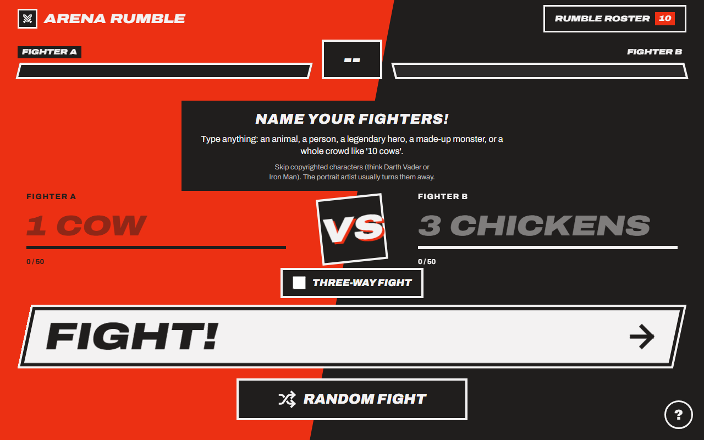
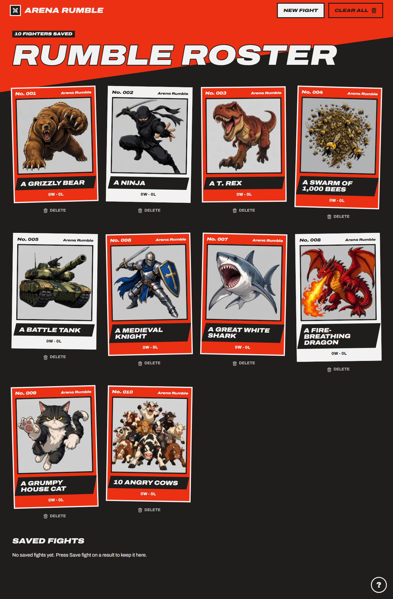
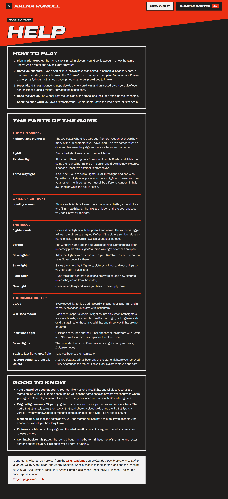

Arena Rumble -- Who Would Win? AI Verdicts and Art for Any Two Fighters
=======================================================================

##### Vox Securitatis | Brock Frary | Published: 2026-11-12

       

Type two fighters, or three if you tick the box. An AI judge decides who would win and explains why, and an AI artist draws a portrait of each. Save the fighters you like to your Rumble Roster, keep a win/loss record on every card, and fight them again later. The fighters can be anything: an animal, a person, a legendary hero, a made-up monster, or a whole crowd like "10 cows".

* * *

Acknowledgment
--------------

**Arena Rumble began as a project from the course _Claude Code for Beginners: Thrive in the AI Era_ by Aldo Pagani and Andrei Neagoie at [ZTM Academy](https://academy.zerotomastery.io/).** Special thanks to them for the idea and the teaching. The course supplied the starting project and its stage-by-stage method; the game here was then rebuilt and extended well beyond it, and every addition is listed below.

* * *

> **Status:** In progress. The MVP (Stages 0-7) and the post-MVP Stages 8-14 are built and deployed. Still to come: a database backend (Stage 15) so the roster syncs across devices, and finally making the live site public. The deployed site is currently kept behind Vercel Authentication on purpose, so there is no public demo link yet.
>
> **License and source:** MIT-licensed. The source code is private for now; this repository is the public showcase (README, screenshots and, later, explainer documents).

Screenshots
-----------

Desktop views of the finished app. More, including phone views and a full fight result, will be added to the [`screenshots/`](screenshots/) folder.

| Main screen | Rumble Roster |
|---|---|
|  |  |

Overview
--------

| Piece | What it does |
|---|---|
| Judge | Claude reads the two (or three) fighters as data and returns a winner, spelled exactly as typed, plus the reasoning. |
| Underdog upset | When the judge sees a clear underdog, the server rolls a 17.5% chance that the underdog wins anyway, with a colorful reason and an "Upset!" tag. |
| Artist | `gpt-image-2` draws one portrait per fighter. A refused or failed image shows a placeholder and the fight still gets a verdict. |
| Rumble Roster | Saved fighters are trading cards with a number, a portrait and a win/loss record. Pick any two cards to fight them with their saved art. |
| Saved fights | Save a whole fight (fighters, pictures, winner, reasoning) and re-open it later. |
| Random fight | Fights two different saved fighters using their saved portraits, so it draws no new pictures. |
| Three-way fight | A tick box adds a Fighter C. All three fight and one wins. |
| Help page | `help.html`, reachable from the round **?** button on every screen: how to play, a glossary of each screen, and credits. |

Architecture
------------

The frontend is plain HTML, CSS and JavaScript with no framework and no build step. A single serverless function does the AI work:

    Browser (index.html, script.js)
        |  POST /api/fight  { fighterA, fighterB, fighterC? }
        v
    api/fight.js (Vercel function, 60-second limit)
        1. rate limit        Upstash Redis, 5 requests / 60 s / IP (fails open)
        2. validate          non-empty, 50 characters max, names all different
        3. verdict           Claude, reply shape enforced by a zod schema
        4. winner check      must equal a fighter's name exactly
        5. portraits         gpt-image-2, in parallel, one failure never fails the fight
        v
    Browser shows the result; Rumble Roster and saved fights live in Supabase (planned, Stage 15)

| Decision | Reasoning |
|---|---|
| Fighter names go in a labeled user message, never the system prompt | The text is data, not instructions, which blocks prompt-injection names. |
| Winner is matched by exact text | The page picks the winning side by string match, so a paraphrase from the model would silently pick the wrong side. |
| The upset roll is in server code | A language model cannot roll a fair 17.5%. |
| Rate limit counted in Upstash Redis | Vercel functions do not share memory, so an in-code counter would not work. |
| Storage in IndexedDB with stable IDs (until Stage 15) | Roomier than `localStorage`, and cards keep their identity for records and future sync. Stage 15 replaces it with Supabase: Google sign-in, a database keyed by the user ID with Row Level Security, and portraits in file storage. Every account starts fresh with 12 starter fighters; old browser data is not imported. |

Repository structure
--------------------

The source lives in a private repository. Its layout, for reference:

    arena_rumble/
    |-- index.html, script.js        # main page: form, loading, result, error views
    |-- roster.html, roster.js       # Rumble Roster: cards, picking, saved fights
    |-- help.html                    # Help page (plain HTML, Stage 14)
    |-- roster-storage.js            # the only file that touches saved data (IndexedDB)
    |-- default-roster.js            # the 10 starter fighters (generated)
    |-- messages.js                  # announcer-voice wording for the UI
    |-- style.css                    # the Stage 6 "arcade versus screen" look
    |-- api/
    |   |-- fight.js                 # the serverless function
    |   |-- judge-prompt.js          # judge prompts and zod output schemas
    |   `-- art-style.js             # shared image style
    |-- scripts/                     # attack-test runner, default-roster tools
    |-- project-brief.md             # scope
    |-- roadmap.md                   # big picture and progress
    |-- project-build.md             # the ordered stage plan
    |-- prompt-tests.md              # results of the judge attack tests
    |-- CLAUDE.md                    # guidance for Claude Code
    `-- .env.example                 # variable names only, no values

_Not published: `.env`, `images/`, `tools/` and `context/` stay out of git._

Prerequisites
-------------

_The source is private for now, so this section and the next document how the project is set up and run, for reference._

* Node.js and npm
* The [Vercel CLI](https://vercel.com/docs/cli) (`vercel dev` is the only way to run the full app locally)
* An Anthropic API key, an OpenAI API key, and an Upstash Redis database (the last is optional locally: without it rate limiting is simply off)

Copy `.env.example` to a new file named `.env`, fill in your own values, and keep it out of git:

    ANTHROPIC_API_KEY=
    OPENAI_API_KEY=
    UPSTASH_REDIS_REST_URL=
    UPSTASH_REDIS_REST_TOKEN=

Running it
----------

    npm install
    vercel dev

Then open the address `vercel dev` prints. The form view alone can be checked with any static server, since it makes no API calls. There is no automated test suite; the judge's defenses are exercised with an attack script (it calls the real judge, so it costs a little):

    node scripts/run-prompt-tests.js [baseUrl] [runsPerCase]

Results are recorded in `prompt-tests.md`.

Build history
-------------

* **Stages 0-7 (MVP):** scaffold, static UI, judge prompt, fight API, Rumble Roster, image compression, Claude Design redesign, deploy.
* **Stage 8:** judge prompt hardening and attack tests.
* **Stage 9:** rate limiting.
* **Stage 10:** IndexedDB storage with stable IDs.
* **Stage 11:** saved fights.
* **Stage 12:** win/loss records.
* **Stage 13:** three-way fight.
* **Stage 14:** Help page and a consistent button style.
* **Also added:** underdog upset, form instructions, pick-two-from-roster, Random fight, a default roster of 10, placeholder portraits when an image fails.
* **Still to come:** database backend (Stage 15); making the live site public.

A note on the characters
------------------------

**Please use original fighters.** The image service usually refuses famous copyrighted characters; that card then shows a placeholder and the fight still gets a verdict. The refusal is not guaranteed, and the judge itself rules on any name.

A note on your data
-------------------

Today (until Stage 15 is built) your roster and saved fights are stored in your own browser, on your own device: other browsers and devices do not see them, and clearing the browser's site data erases them.

Once Stage 15 ships, your roster, saved fights and win/loss records will be stored online with your Google account. You sign in to play, you see the same data on every device, and other players cannot see yours. Every new account starts with 12 starter fighters, and data already in a browser is not imported.

* * *

> &copy; 2026 Vox Securitatis / Brock Frary. Arena Rumble is released under the [MIT License](LICENSE). The source code is private for now.
>
> Arena Rumble began as a project from the ZTM Academy course _Claude Code for Beginners: Thrive in the AI Era_ by Aldo Pagani and Andrei Neagoie. Special thanks to them for the idea and the teaching.
